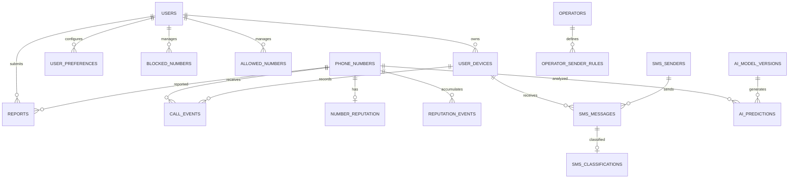

# Lógica de bloqueio móvel

**User:** Anonymous  
**Created:** 11/12/2026 16:25:59  
**Updated:** 11/12/2026 16:29:58  
**Exported:** 11/12/2026 16:49:31  
**Link:** [https://chatgpt.com/c/6af612c6-ef9c-83e9-97d8-8644a09b9671](https://chatgpt.com/c/6af612c6-ef9c-83e9-97d8-8644a09b9671)  

## Prompt:
12/11/2026, 16:27:05

construa a logica de um aplicativo completo que consiga bloquear as chamadas de numeros de call, center e qualquer outro tipo de chamada não altorizada, call centers entre oturos serviços e que bloqueio sms de operadoras tambem

## Response:
12/11/2026, 16:27:11 · gpt-6

> **Estruturando o aplicativo**
>
> Estou organizando a solução em torno de um MVP Android, porque o sistema oferece mais controle sobre chamadas, SMS e notificações. Vou separar identificação, bloqueio, registros, permissões e uma base atualizável de números verificados.
> 
> **Definindo as limitações**
> 
> Estou considerando que iOS terá restrições maiores: bloqueio e identificação de chamadas são possíveis, mas SMS e chamadas de aplicativos exigem recursos específicos. No Android, bloqueio completo de SMS pode exigir que o app seja o aplicativo padrão de mensagens.
> 
> **Montando a lógica**
> 
> Vou combinar listas oficiais, prefixos, reputação comunitária, análise de padrões e confirmação do usuário. Cada contato receberá uma classificação explicável, evitando bloquear automaticamente números importantes sem permitir revisão.
> 
> **Planejando a implementação**
> 
> A arquitetura pode usar banco local, sincronização segura, serviço de filtragem de chamadas, classificador de mensagens e painel de histórico. O próximo passo ideal é escolher Android nativo, Flutter ou React Native e detalhar o MVP.
>
> **Estruturou o aplicativo**
>
> 
>
> **Especificando a solução**
>
> Estou separando SMS comuns, mensagens da operadora, USSD, transmissões celulares, RCS e aplicativos como WhatsApp, porque o aplicativo não controla tudo. No Android, filtragem completa exige integração adequada e permissões específicas.
> 
> **Definindo o classificador**
> 
> Vou usar listas oficiais, prefixo 0303, remetentes, frequência, conteúdo suspeito e denúncias explícitas. A pontuação terá faixas: permitir, alertar, silenciar ou bloquear, sempre com lista de exceções.
> 
> **Projetando a arquitetura**
> 
> Recomendo Kotlin nativo, banco local offline, sincronização opcional e backend simples para dados públicos. Entidades incluem contatos, eventos, regras, remetentes, decisões e justificativas. O histórico deve mostrar por que cada bloqueio ocorreu.
> 
> **Limitando promessas**
> 
> Não vou prometer bloqueio total: identificadores de chamadas podem ser falsificados, operadoras controlam algumas mensagens e plataformas impõem restrições. Também preciso validar cuidadosamente privacidade, permissões e regras de distribuição antes de lançar.
> 
> **Planejando etapas**
> 
> Começaria com identificação e bloqueio de chamadas, depois SMS, relatórios manuais, painel de revisão e atualização das listas. A primeira versão deve priorizar transparência, reversão rápida e baixo risco de falsos positivos.
>
> **Especificada a solução**
>
> 
>
> **Pesquisou 10 sites**
>
> 
>
> Pensou por 29s

# Projeto: aplicativo inteligente de bloqueio de chamadas e SMS

A proposta é desenvolver um aplicativo completo de proteção contra ligações indesejadas, telemarketing, robocalls, cobranças automatizadas, golpes telefônicos e mensagens comerciais de operadoras.

Minha recomendação é construir um aplicativo que não dependa apenas de uma lista fixa de números bloqueados. Ele deve possuir um **motor inteligente de identificação, classificação e bloqueio**, capaz de aprender com os números denunciados pelos usuários e atualizar suas próprias bases de proteção.

O objetivo é simples: **o telefone só deve receber chamadas e mensagens de quem o usuário autorizar ou de quem não apresentar características de comunicação indesejada.**

Vou estruturar o projeto como um produto comercial, preparado inicialmente para Android e com arquitetura que permita uma futura versão para iOS.

## 1\. Conceito e funcionamento

[](https://us.norton.com/blog/security-tips/how-to-block-spam-calls)

**Proteção de chamadas**

Identificação e bloqueio de telemarketing, robôs, números denunciados e chamadas suspeitas.

---

[](https://www.robokiller.com/best-robocall-blocker-app)

**Proteção de SMS**

Bloqueio de mensagens promocionais, disparos automáticos, publicidade de operadoras e tentativas de fraude.

---

[](https://dribbble.com/shots/27494297-AI-Cyber-Security-Mobile-App-UI-Design)

**Inteligência coletiva**

Banco de dados compartilhado, reputação dos números, denúncias e classificação automática de ameaças.

## 2\. Motor inteligente de identificação

O aplicativo deverá analisar cada chamada recebida utilizando diferentes critérios.

### Classificação de chamadas

| Categoria | Comportamento |
|--------|--------|
| Contatos autorizados | Permitir |
| Números pessoais desconhecidos | Permitir ou consultar configuração |
| Telemarketing | Bloquear |
| Call centers | Bloquear |
| Robocalls | Bloquear |
| Cobranças automatizadas | Bloquear conforme regra |
| Números denunciados | Bloquear |
| Golpes conhecidos | Bloquear |
| Números falsificados suspeitos | Sinalizar ou bloquear |
| Serviços de operadoras | Bloquear conforme preferência |
| Números comerciais legítimos | Permitir conforme configuração |

Uma característica importante: não devemos bloquear indiscriminadamente todos os números desconhecidos. Isso poderia impedir chamadas de médicos, entregadores, clientes, bancos e outros serviços legítimos.

O sistema deve permitir que o usuário escolha o nível de rigor.

## 3\. Sistema de pontuação de risco

O núcleo do aplicativo será um mecanismo chamado *SmartCall Engine*\.

Cada chamada recebe uma pontuação de risco entre 0 e 100.

Exemplo de regras\:

| Critério identificado | Pontos |
|--------|--------|
| Número presente na lista pessoal de bloqueio | 100 |
| Número denunciado como golpe | 100 |
| Prefixo 0303 | \+90 |
| Número classificado como telemarketing | \+90 |
| Número associado a robocall | \+95 |
| Número com denúncias consistentes | \+60 |
| Identificação de disparos em massa | \+50 |
| Número comercial verificado | \-40 |
| Número presente nos contatos | Liberação prioritária |

Esses valores são parâmetros iniciais, ajustáveis durante os testes.

**Decisão do SmartCall Engine**

0-29 · Baixo risco (Permitir)

30-69 · Suspeito (Identificar)

70-100 · Alto risco (Bloquear)

A lista de permissões tem prioridade sobre a pontuação. O usuário poderá alterar os limites de bloqueio.

### Exemplo de funcionamento

Imagine que um número desconhecido ligue\:

1. O sistema identifica o número.
2. Consulta a lista de contatos autorizados.
3. Consulta a base local de números conhecidos.
4. Verifica se pertence a uma faixa de telemarketing.
5. Analisa a reputação e as denúncias.
6. Calcula o risco.
7. Decide se permite, identifica, silencia ou bloqueia.
8. Registra o resultado no histórico.

A decisão precisa ser local e extremamente rápida. A consulta ao servidor será complementar, nunca obrigatória para bloquear uma chamada.

## 4\. Proteção contra SMS

Esse módulo será tão importante quanto o bloqueador de chamadas.

### Categorias de mensagens bloqueadas

- Propagandas de operadoras.
- Ofertas de pacotes de internet.
- Mensagens de renovação de planos.
- Publicidade de serviços.
- Disparos promocionais.
- Mensagens de telemarketing.
- SMS de cobrança automatizada, se configurado.
- Mensagens fraudulentas.
- Links suspeitos.
- Mensagens de remetentes denunciados.
- Mensagens repetitivas enviadas por sistemas automatizados.

### Identificação inteligente de SMS

O mecanismo deve analisar\:

**1\. Remetente\:** número telefônico, código curto ou identificador alfanumérico.

**2\. Conteúdo\:** palavras, expressões, padrões publicitários e links.

**3\. Frequência\:** repetição de mensagens e disparos.

**4\. Classificação\:** publicidade, cobrança, autenticação, informação de serviço ou fraude.

**5\. Preferências\:** regras específicas para cada operadora e remetente.

Exemplo\:

**Mensagem recebida** (Bloqueada)

REMETENTE: OPERADORA

Prezado cliente\! Aproveite nossa oferta especial. Contrate agora seu novo pacote de internet e ganhe benefícios exclusivos. Responda SIM.

Classificação automática **Publicidade comercial**

Motivo: remetente comercial, linguagem promocional e chamada para contratação.

**Uma distinção técnica importante\:** SMS convencional pode ser filtrado pelo aplicativo Android quando ele possui os privilégios necessários. Mensagens de transmissão celular, notificações de rede, USSD e algumas mensagens de serviço enviadas diretamente pela operadora não são necessariamente controláveis por um aplicativo comum. Para essas situações, será necessário utilizar controles da própria operadora, quando disponíveis.

## 5\. Banco de dados inteligente

O aplicativo terá uma base local e uma base central de inteligência.

Estrutura proposta\:

| Tabela | Finalidade |
|--------|--------|
| phone\_numbers | Cadastro e identificação de números |
| number\_reputation | Pontuação de reputação |
| blocked\_numbers | Números bloqueados |
| allowed\_numbers | Números autorizados |
| reports | Denúncias classificadas |
| call\_history | Histórico de chamadas filtradas |
| sms\_rules | Regras de filtragem de SMS |
| sms\_senders | Remetentes conhecidos |
| spam\_patterns | Padrões de mensagens indesejadas |
| operator\_rules | Regras por operadora |
| user\_settings | Preferências individuais |
| whitelist\_patterns | Prefixos e remetentes permitidos |

### Atualização da inteligência

O sistema deverá\:

- Atualizar listas de números conhecidos.
- Sincronizar regras de bloqueio.
- Identificar números reincidentes.
- Permitir denúncias manuais.
- Permitir contestação de classificações incorretas.
- Manter uma lista de números comerciais verificados.
- Ter proteção contra denúncias maliciosas.

Não recomendo compartilhar automaticamente conteúdo de SMS, contatos ou registros pessoais entre usuários. A inteligência coletiva deve trabalhar com informações públicas, bases legítimas e denúncias voluntárias, respeitando a LGPD e as regras da Google Play.

## 6\. Interface gráfica completa

Minha proposta visual seria uma interface tecnológica, com fundo grafite, preto, elementos glass, detalhes laranja e indicadores de proteção.

[](https://www.stacksocial.com/sales/robokiller-3-year-subscription)

[](https://lanjiemao.com/)

[](https://habr.com/ru/news/1056982/)

[](https://www.robokiller.com/free)

[](https://meta.appinn.net/t/topic/73067)

[](https://www.blockguard.app/)

[](https://trusterprise.com/)

[](https://fossdroid.com/a/spamblocker-call-sms.html)

[](https://lizhi.shop/products/panda-anti-spam)

[](https://www.europe-etiquettes.fr/logiciel/alternatives-a-bloctel-efficaces-guide-complet-stopper-demarchage-telephonique)

[](https://web.whoscall.com/en/features)

### Telas necessárias

| Tela | Funcionalidade |
|--------|--------|
| Splash Screen | Apresentação da marca |
| Introdução | Explicação da proteção |
| Configuração inicial | Permissões e funções padrão |
| Dashboard | Resumo da proteção |
| Proteção de chamadas | Configuração do bloqueio |
| Proteção de SMS | Configuração dos filtros |
| Histórico | Chamadas e mensagens bloqueadas |
| Lista de bloqueios | Gerenciamento manual |
| Lista de permissões | Contatos e números liberados |
| Identificação | Consulta de números |
| Denunciar número | Enviar denúncia |
| Regras inteligentes | Personalizar critérios |
| Operadoras | Regras específicas de remetentes |
| Estatísticas | Quantidade de ameaças bloqueadas |
| Banco de reputação | Consulta de números |
| Privacidade | Dados e permissões |
| Configurações | Personalização geral |

### Dashboard principal

# ORANGE SHIELD

SMART COMMUNICATION PROTECTION

(Protegido)

**Sua proteção está ativa**

# 100%

Motor de proteção operacional

# 127

Chamadas bloqueadas

# 84

SMS bloqueados

# 19

Golpes identificados

# Atualizada

Base de inteligência

**Proteções ativadas**

Bloqueio de telemarketing (Ativo)

Bloqueio de robocalls (Ativo)

Filtro de SMS comercial (Ativo)

Proteção contra golpes (Ativo)

Prévia conceitual da interface - números ilustrativos.

## 7\. Arquitetura técnica e tecnologias

Para que o aplicativo realmente consiga bloquear chamadas e mensagens, recomendo desenvolvimento nativo, e não um aplicativo feito apenas com tecnologias web.

**Arquitetura geral**

**Aplicativo Android**

Interface, configurações e gerenciamento

**Call Engine**

CallScreeningService

**SMS Engine**

Default SMS Role

**SmartCall Engine**

Classificação, pontuação, regras e reputação local

**Backend de inteligência**

API, banco central, atualização e administração

### Tecnologias recomendadas

| Camada | Tecnologia |
|--------|--------|
| Aplicativo | Kotlin |
| Interface | Jetpack Compose |
| Bloqueio telefônico | Android CallScreeningService |
| Recebimento de SMS | Android SMS Role |
| Banco local | Room / SQLite |
| Processamento | Kotlin |
| Backend | Python / FastAPI |
| Banco central | PostgreSQL |
| Cache | Redis |
| Comunicação | REST API |
| Segurança | HTTPS, criptografia e autenticação |
| Administração | Dashboard Web |

### Por que Kotlin?

Porque precisamos acessar diretamente os recursos do sistema operacional.

O Android oferece a API `CallScreeningService`, que permite decidir se uma chamada recebida deve tocar ou ser bloqueada. Existe um limite de cinco segundos para responder, portanto a identificação deve utilizar uma base local rápida. \[[CallScreeningService  \|  API reference  \|  Android Developers](https://developer.android.com/reference/android/telecom/CallScreeningService?utm_source=chatgpt.com); [Android roles  \|  Android OS core topics  \|  Android Open Source Project](https://source.android.com/docs/core/permissions/android-roles?utm_source=chatgpt.com)\]

Para SMS, existe uma restrição importante: o aplicativo precisa assumir o papel de aplicativo padrão de mensagens para receber diretamente o SMS destinado ao usuário e gerenciá-lo integralmente. \[[Telephony  \|  API reference  \|  Android Developers](https://developer.android.com/reference/android/provider/Telephony?utm_source=chatgpt.com); [Permissions used only in default handlers  \|  Privacy  \|  Android Developers](https://developer.android.com/guide/topics/permissions/default-handlers?authuser=1&utm_source=chatgpt.com)\]

**Consequentemente, o Orange Shield deverá oferecer uma interface própria de mensagens**, caso o usuário queira ativar o bloqueio completo de SMS.

### 8\. Particularidades do Brasil

Precisamos aproveitar os mecanismos brasileiros de identificação de telemarketing.

Um exemplo importante é o prefixo **0303**\.

A Anatel ampliou sua utilização para organizações que realizam mais de 10 mil chamadas diárias, com a regra entrando em vigor em janeiro de 2025. Isso pode ser utilizado como um dos indicadores de classificação de chamadas. \[[Anatel amplia 0303 no combate às chamadas indesejadas](https://www.gov.br/anatel/pt-br/assuntos/noticias/anatel-amplia-0303-no-combate-as-chamadas-indesejadas/?utm_source=chatgpt.com)\]

Outras integrações que podemos considerar\:

- Identificação de chamadas com prefixo 0303.
- Bases públicas e legítimas de identificação comercial.
- Cadastro de remetentes de SMS por operadora.
- Listas de números fraudulentos.
- Regras de bloqueio configuráveis por operadora.
- Orientação para cadastro no serviço Não Me Perturbe.

Não devemos presumir que toda chamada sem 0303 seja legítima ou que toda chamada com 0303 seja fraude.

### 9\. Uma limitação importante: iPhone

Eu desenvolveria primeiro para Android.

No iOS, a Apple oferece extensões para identificação e bloqueio de números telefônicos, além de extensões específicas para filtragem de SMS. Entretanto, as possibilidades são diferentes das disponíveis no Android. \[[Identifying and blocking calls](https://developer.apple.com/documentation/CallKit/identifying-and-blocking-calls?utm_source=chatgpt.com); [SMS and Call Reporting](https://developer.apple.com/documentation/identitylookup?changes=__3&language=objc&utm_source=chatgpt.com)\]

| Recurso | Android | iOS |
|--------|--------|--------|
| Bloquear chamadas | Sim | Sim |
| Identificar chamadas | Sim | Sim |
| Filtrar SMS | Sim, com SMS padrão | Sim, por extensão |
| Controle completo da caixa SMS | Com limitações do papel padrão | Não |
| Regras personalizadas | Amplo controle | Mais restrito |
| Banco de reputação | Sim | Sim, com limitações de integração |

---

## 10\. Segurança, privacidade e confiabilidade

Quero incluir algumas regras obrigatórias no projeto\:

1. Contatos autorizados nunca serão bloqueados automaticamente.
2. Números de emergência nunca serão incluídos nas listas de bloqueio.
3. O usuário poderá recuperar números bloqueados por engano.
4. O bloqueio deve funcionar sem internet.
5. O aplicativo não deve enviar conversas ou SMS completos para o servidor.
6. Denúncias deverão ser voluntárias e protegidas contra manipulação.
7. O aplicativo deverá ter logs de decisão, explicando por que bloqueou cada número.
8. A base deverá ter atualização incremental e assinatura digital.
9. Números identificados como falsificados não devem ser tratados como prova absoluta de fraude.
10. Deve existir um modo de proteção reversível, para evitar perda de chamadas importantes.

Também será necessário observar a política de permissões da Google Play: acesso a SMS e registros telefônicos é restrito e depende do papel padrão apropriado e da aprovação das permissões aplicáveis. A inteligência compartilhada entre usuários deverá ser projetada com cuidado para não violar essas regras. \[[Use of SMS or Call Log permission groups](https://support.google.com/googleplay/android-developer/answer/10208820?rd=1&utm_source=chatgpt.com); [Permissions used only in default handlers  \|  Privacy  \|  Android Developers](https://developer.android.com/guide/topics/permissions/default-handlers?authuser=1&utm_source=chatgpt.com)\]

## 11\. Plano de desenvolvimento

Eu dividiria o desenvolvimento em seis etapas, para não construir uma interface bonita que depois não consegue executar os bloqueios.

1. **Fundação Android**
   
   - Criar projeto Kotlin.
   - Configurar permissões e papéis do Android.
   - Criar banco local.
   - Implementar contatos autorizados e bloqueios manuais.
2. **Motor de chamadas**
   
   - Implementar CallScreeningService.
   - Identificar números.
   - Aplicar regras de risco.
   - Bloquear e registrar chamadas.
3. **Motor de SMS**
   
   - Criar aplicativo de mensagens.
   - Implementar recebimento de SMS.
   - Criar filtros por remetente e conteúdo.
   - Criar caixa de mensagens bloqueadas.
4. **Inteligência**
   
   - Implementar pontuação de risco.
   - Criar classificação de telemarketing.
   - Identificar robocalls.
   - Implementar reputação e denúncias.
5. **Backend e administração**
   
   - Criar API.
   - Implementar PostgreSQL.
   - Criar atualização das bases.
   - Criar painel administrativo.
6. **Finalização**
   
   - Testar em diferentes fabricantes.
   - Testar dual SIM.
   - Testar ausência de internet.
   - Otimizar consumo de bateria.
   - Preparar APK e publicação.

## 12\. Exemplo da lógica central

Este é o comportamento simplificado que deverá orientar o desenvolvimento\:

```python

def analyze_incoming_call(number, user, database):

    number = normalize_phone(number)

    # Proteção prioritária
    if number in user.emergency_allowlist:
        return "ALLOW"

    if number in user.contacts:
        return "ALLOW"

    if number in user.allowed_numbers:
        return "ALLOW"

    # Bloqueios explícitos
    if number in user.blocked_numbers:
        return "BLOCK"

    reputation = database.get_reputation(number)

    if reputation.is_confirmed_fraud:
        return "BLOCK"

    score = 0

    if number.startswith("0303"):
        score += 90

    if reputation.telemarketing:
        score += 90

    if reputation.robocall:
        score += 95

    score += reputation.complaint_score

    if reputation.verified_business:
        score -= 40

    if score >= user.block_threshold:
        return "BLOCK"

    if score >= user.warning_threshold:
        return "WARN"

    return "ALLOW"
```

Na implementação real, os critérios terão pesos normalizados, tratamento de números mascarados, regras específicas de operadoras e mecanismos de prevenção contra falsos positivos.

## 13\. Recursos que eu acrescentaria para tornar o produto superior

- **Bloqueio por prefixo\:** bloquear faixas inteiras de números.
- **Bloqueio por padrão\:** detectar sequências de números usadas em campanhas.
- **Modo silêncio total\:** permitir somente contatos autorizados.
- **Proteção contra insistência\:** identificar números que ligam repetidamente.
- **Bloqueio de chamadas internacionais\:** configurável.
- **Proteção contra spoofing\:** sinalizar possíveis números falsificados.
- **Lista de exceções\:** bancos, hospitais, entregadores e serviços importantes.
- **Painel de operadoras\:** regras individuais para Claro, Vivo, TIM e outras.
- **Relatório semanal\:** mostrar quantas chamadas e mensagens foram impedidas.
- **Modo viagem\:** regras diferentes para quando o usuário estiver viajando.

Um detalhe que considero especialmente importante: o aplicativo deve permitir bloquear chamadas de números desconhecidos que não estejam nos contatos, mas também deve oferecer uma opção para liberar chamadas importantes. Isso evita transformar a proteção em isolamento telefônico.

---

# 14\. Definição final do produto

[](https://www.experaconsulting.com/en/blog)

# ORANGE SHIELD

SMART CALL &amp; MESSAGE PROTECTION

(Conceito definido)

**Objetivo\:** proteção inteligente contra comunicações indesejadas.

**Plataforma inicial\:** Android.

**Expansão\:** iOS e painel web.

**Modelo\:** aplicativo independente com inteligência local e serviço central de atualização.

**Diferencial\:** proteção de chamadas e SMS com regras personalizadas, identificação comercial e classificação inteligente.

---

**Critério de sucesso**

O aplicativo deve conseguir bloquear chamadas e mensagens indesejadas sem depender de conexão com a internet, preservando as comunicações autorizadas.

## 15\. Uma decisão antes de iniciar a implementação

Precisamos definir o alcance da primeira versão, porque isso altera bastante a arquitetura e o trabalho de desenvolvimento.

**1\. Plataforma de desenvolvimento**

Android primeiro (recomendado)

Android e iOS desde o início

Android, incluindo aparelhos especiais e versões adaptadas

---

**2\. Nível de bloqueio de SMS**

Bloqueio completo com aplicativo próprio de mensagens

Somente filtragem de mensagens indesejadas

---

**3\. Inteligência do sistema**

Banco local, sem depender de servidor

Inteligência local + banco central atualizado (recomendado)

Inteligência híbrida + agentes de IA para análise e classificação

---

**4\. Distribuição**

Google Play Store

APK independente

Google Play + APK independente

[Definir arquitetura e iniciar projeto]

Minha escolha seria Android primeiro, SMS completo, inteligência híbrida e distribuição pela Play Store e APK independente. Isso permite construir um produto realmente funcional, em vez de apenas um identificador de chamadas.

## Prompt:
12/11/2026, 16:29:02

Defini as especificações do ORANGE SHIELD:
Plataforma: android_tv
SMS: complete
Inteligência: ai
Distribuição: both
Agora desenvolva a especificação técnica definitiva, a arquitetura de pastas, o banco de dados, os módulos e um prompt completo para implementar o aplicativo.

## Response:
12/11/2026, 16:29:09 · gpt-6

> **Pesquisou 4 sites**
>
> 
>
> Pensou por 48s

# ORANGE SHIELD - Especificação técnica definitiva

[](https://conferences.bgu.ac.il/cs2026/Cyber)

# ORANGE SHIELD

**SMART COMMUNICATION SECURITY**

ANDROID · AI ENGINE · CALL &amp; SMS PROTECTION

(Projeto especificado)

Vamos tratar o ORANGE SHIELD como um produto de software completo, não apenas como um bloqueador de números.

A arquitetura terá quatro pilares\:

1. **Proteção telefônica\:** identificar e bloquear chamadas indesejadas.
2. **Proteção de mensagens\:** administrar SMS e separar mensagens legítimas de publicidade, golpes e disparos comerciais.
3. **Inteligência artificial\:** analisar reputação, padrões, denúncias e comportamento de números e remetentes.
4. **Inteligência coletiva\:** atualizar as bases de proteção através de um servidor central.

Uma observação técnica importante sobre a opção Android TV: aparelhos Android TV e TV Box normalmente não possuem telefonia celular, slot SIM ou infraestrutura de SMS. Portanto, vamos desenvolver o núcleo para Android com telefonia e adaptar a interface para aparelhos especiais. O bloqueio real de chamadas e SMS será habilitado somente em dispositivos compatíveis. Uma TV Box poderá funcionar como painel de administração, visualização de relatórios ou central de gerenciamento, sem prometer bloquear chamadas que ela não recebe.

**Decisão arquitetural\:** Android nativo com Kotlin, Jetpack Compose e módulos independentes, compartilhando o mesmo motor de inteligência.

## 1\. Especificação funcional definitiva

**Matriz de compatibilidade**

| Plataforma | Chamadas | SMS | Painel |
|--------|--------|--------|--------|
| Android celular com SIM | (Completo) | (Completo) | Sim |
| Android tablet com telefonia | (Compatível) | (Compatível) | Sim |
| Android tablet sem telefonia | Não disponível | Não disponível | Sim |
| Android TV | Não disponível normalmente | Não disponível normalmente | Sim |
| TV Box | Depende do hardware | Depende do hardware | Sim |
| Emulador Android | Simulação | Simulação | Sim |

A detecção das capacidades será automática por meio do sistema Android. O aplicativo não poderá anunciar proteção ativa quando o dispositivo não oferecer os recursos necessários.

### 1.1 Versões do produto

Vamos organizar o projeto em três aplicações complementares\:

- **Orange Shield Mobile\:** aplicação principal para celulares, com bloqueio de chamadas, SMS e inteligência artificial.
- **Orange Shield Control\:** painel adaptado para tablets, TV Box e Android TV.
- **Orange Shield Cloud\:** backend central, banco de reputação, API, processamento inteligente e painel administrativo web.

Os três produtos compartilharão a mesma identidade visual, API e estrutura de dados.

### 1.2 Funcionalidades obrigatórias

| Código | Módulo | Prioridade |
|--------|--------|--------|
| OS-001 | Bloqueio de chamadas | Crítica |
| OS-002 | Aplicativo SMS completo | Crítica |
| OS-003 | Lista branca e lista negra | Crítica |
| OS-004 | Identificação de telemarketing | Crítica |
| OS-005 | Identificação de robocalls | Alta |
| OS-006 | Bloqueio de publicidade de operadoras | Alta |
| OS-007 | Inteligência artificial | Alta |
| OS-008 | Banco coletivo de reputação | Alta |
| OS-009 | Denúncias de usuários | Alta |
| OS-010 | Histórico e auditoria | Alta |
| OS-011 | Atualização offline | Alta |
| OS-012 | Painel administrativo | Alta |
| OS-013 | Estatísticas | Média |
| OS-014 | Sincronização de dispositivos | Média |
| OS-015 | Interface Android TV | Média |

## 2\. Arquitetura técnica

Minha recomendação é utilizar uma arquitetura modular, com separação entre o aplicativo, o motor de proteção e a inteligência artificial.

[](https://research.contrary.com/company/cybereason)

### 2.1 Stack tecnológica

| Componente | Tecnologia |
|--------|--------|
| Linguagem mobile | Kotlin |
| Interface | Jetpack Compose |
| Arquitetura | Clean Architecture + MVVM |
| Injeção de dependências | Hilt |
| Concorrência | Kotlin Coroutines / Flow |
| Banco local | Room / SQLite |
| Preferências | DataStore |
| Chamadas | Android Telecom API |
| SMS | Android Telephony API |
| Backend | Python 3.12+ / FastAPI |
| Banco central | PostgreSQL |
| Cache | Redis |
| Comunicação | REST / HTTPS |
| Processamento assíncrono | Celery ou worker equivalente |
| IA | Python, modelos classificadores e regras híbridas |
| Administração web | React / TypeScript |
| Infraestrutura | Docker |
| Testes | JUnit, MockK, Pytest |

A versão do Android, Gradle, Kotlin e dependências deverá ser definida pelo Codex com base nas versões estáveis compatíveis no início da implementação, evitando dependências desatualizadas.

### 2.2 Os três motores de proteção

**ENGINE 01 - CALL GUARD**

- Interceptação de chamadas recebidas.
- Normalização de números brasileiros.
- Consulta local de reputação.
- Aplicação de regras de bloqueio.
- Registro da decisão.
  
  (Execução local)

---

**ENGINE 02 - SMS GUARD**

- Recebimento e gerenciamento de SMS.
- Classificação de publicidade.
- Identificação de golpes e links suspeitos.
- Bloqueio e quarentena.
- Caixa de mensagens e restauração.
  
  (Execução local)

---

**ENGINE 03 - AI SHIELD**

- Análise de padrões.
- Reputação coletiva.
- Classificação contextual de SMS.
- Detecção de campanhas.
- Atualização inteligente de regras.
  
  (Local + servidor)

### 2.3 Regras de execução

Uma das decisões mais importantes: a IA não poderá atrasar o bloqueio de chamadas.

O `CallScreeningService` precisa responder em até cinco segundos. A classificação inicial deverá ser feita usando regras e dados locais, sem depender de requisição à nuvem. \[[CallScreeningService  \|  API reference  \|  Android Developers](https://developer.android.com/reference/android/telecom/CallScreeningService?utm_source=chatgpt.com); [telecomm/java/android/telecom/CallScreeningService.java - platform/frameworks/base](https://android.googlesource.com/platform/frameworks/base/%2B/HEAD/telecomm/java/android/telecom/CallScreeningService.java?utm_source=chatgpt.com)\]

O fluxo será\:

```text
CHAMADA RECEBIDA
       |
       v
NORMALIZAR NÚMERO
       |
       v
CONSULTAR LISTA LOCAL
       |
       v
CONSULTAR REGRAS E REPUTAÇÃO
       |
       v
CALCULAR RISCO
       |
       +---- AUTORIZADO ----> PERMITIR
       |
       +---- SUSPEITO ------> SILENCIAR / PERMITIR
       |
       +---- PERIGOSO ------> BLOQUEAR
       |
       v
REGISTRAR DECISÃO
       |
       v
SINCRONIZAÇÃO POSTERIOR
```

A IA poderá sugerir atualizações para o motor, mas nunca alterar automaticamente as listas de permissão do usuário.

---

## 3\. Sistema de inteligência artificial

Aqui está o diferencial mais importante do ORANGE SHIELD.

Não quero uma IA que simplesmente consulte uma API e diga se um número é spam. Quero um sistema híbrido de classificação.

### 3.1 Agentes inteligentes

(Agente 01)

**Number Intelligence Agent**

Analisa números telefônicos, prefixos, reputação, histórico e padrões de chamadas.

---

(Agente 02)

**Telemarketing Detection Agent**

Identifica campanhas comerciais, centrais de atendimento e disparos automatizados.

---

(Agente 03)

**SMS Fraud Detection Agent**

Analisa conteúdo, remetentes, URLs, tentativas de phishing e padrões de fraude.

---

(Agente 04)

**Collective Intelligence Agent**

Cruza denúncias, reputação e informações compartilhadas para identificar campanhas em escala.

---

(Agente 05)

**False Positive Prevention Agent**

Procura erros de classificação, números legítimos denunciados indevidamente e conflitos entre regras.

---

(Supervisor)

**AI Orchestrator**

Coordena os agentes, consolida resultados e propõe atualizações para a base central.

### 3.2 Inteligência em duas camadas

**Camada local\:**

- Regras determinísticas.
- Modelo leve de classificação.
- Base de reputação sincronizada.
- Análise de remetentes.
- Detecção de palavras e padrões.
- Operação sem internet.

**Camada em nuvem\:**

- Modelos mais avançados.
- Análise de campanhas.
- Cruzamento de denúncias.
- Detecção de novos padrões.
- Reavaliação de falsos positivos.
- Geração de atualizações assinadas.

Não será necessário executar seis modelos grandes simultaneamente no celular. Os agentes serão módulos lógicos, executados por demanda, com processamento pesado concentrado no backend.

### 3.3 Pontuação de risco

O resultado da classificação será baseado em evidências\:

| Pontuação | Resultado |
|--------|--------|
| 0-19 | Confiável |
| 20-39 | Baixo risco |
| 40-59 | Suspeito |
| 60-79 | Alto risco |
| 80-100 | Muito alto risco |

Cada resultado deverá registrar\:

- Número ou remetente analisado.
- Pontuação.
- Evidências encontradas.
- Origem das informações.
- Data da classificação.
- Versão das regras.
- Decisão aplicada.

Uma denúncia isolada não poderá condenar automaticamente um número. Para bloquear números novos por reputação coletiva, deverá existir um nível mínimo de evidência e mecanismos contra manipulação.

---

## 4\. Arquitetura de pastas

Vamos organizar o projeto em um monorepositório, mantendo os módulos independentes.

```text

orange-shield/
│
├── README.md
├── LICENSE
├── .gitignore
├── .env.example
├── docker-compose.yml
├── Makefile
│
├── mobile/
│   ├── settings.gradle.kts
│   ├── build.gradle.kts
│   ├── gradle/
│   │
│   ├── app/
│   │   └── src/main/
│   │       ├── AndroidManifest.xml
│   │       ├── kotlin/com/orange/shield/
│   │       │   ├── OrangeShieldApp.kt
│   │       │   ├── MainActivity.kt
│   │       │   ├── navigation/
│   │       │   ├── di/
│   │       │   ├── ui/
│   │       │   │   ├── theme/
│   │       │   │   ├── components/
│   │       │   │   ├── dashboard/
│   │       │   │   ├── calls/
│   │       │   │   ├── messages/
│   │       │   │   ├── history/
│   │       │   │   ├── whitelist/
│   │       │   │   ├── blacklist/
│   │       │   │   ├── intelligence/
│   │       │   │   ├── reports/
│   │       │   │   ├── settings/
│   │       │   │   └── tv/
│   │       │   └── permissions/
│   │       │
│   │       └── res/
│   │
│   ├── core/
│   │   ├── common/
│   │   ├── database/
│   │   ├── network/
│   │   ├── security/
│   │   ├── design/
│   │   └── testing/
│   │
│   ├── feature/
│   │   ├── callguard/
│   │   ├── smsguard/
│   │   ├── reputation/
│   │   ├── rules/
│   │   ├── reports/
│   │   ├── synchronization/
│   │   └── devicecapabilities/
│   │
│   ├── domain/
│   │   ├── models/
│   │   ├── repositories/
│   │   ├── usecases/
│   │   └── engine/
│   │
│   └── data/
│       ├── local/
│       ├── remote/
│       ├── repositories/
│       └── mappers/
│
├── backend/
│   ├── app/
│   │   ├── main.py
│   │   ├── core/
│   │   │   ├── config.py
│   │   │   ├── security.py
│   │   │   └── logging.py
│   │   ├── api/
│   │   │   └── v1/
│   │   ├── models/
│   │   ├── schemas/
│   │   ├── repositories/
│   │   ├── services/
│   │   ├── agents/
│   │   │   ├── orchestrator.py
│   │   │   ├── number_agent.py
│   │   │   ├── telemarketing_agent.py
│   │   │   ├── sms_agent.py
│   │   │   ├── collective_agent.py
│   │   │   └── false_positive_agent.py
│   │   ├── ml/
│   │   ├── workers/
│   │   └── admin/
│   ├── migrations/
│   ├── tests/
│   ├── requirements.txt
│   └── Dockerfile
│
├── admin-web/
│   ├── src/
│   │   ├── components/
│   │   ├── pages/
│   │   ├── dashboards/
│   │   ├── services/
│   │   ├── hooks/
│   │   └── routes/
│   ├── package.json
│   └── Dockerfile
│
├── database/
│   ├── migrations/
│   ├── seeds/
│   └── schemas/
│
├── ml/
│   ├── datasets/
│   ├── preprocessing/
│   ├── training/
│   ├── evaluation/
│   └── exported_models/
│
├── infrastructure/
│   ├── docker/
│   ├── nginx/
│   ├── monitoring/
│   └── backups/
│
├── docs/
│   ├── ARCHITECTURE.md
│   ├── DATABASE.md
│   ├── API.md
│   ├── SECURITY.md
│   ├── PRIVACY.md
│   ├── INSTALLATION.md
│   └── TESTING.md
│
└── scripts/
    ├── dev.sh
    ├── test.sh
    ├── build-apk.sh
    └── deploy.sh
```

**Regra de arquitetura\:** cada módulo deverá ter responsabilidade definida. A interface não poderá executar diretamente SQL, chamar agentes de IA ou manipular o sistema telefônico. Tudo deverá passar pelos respectivos serviços e casos de uso.

---

## 5\. Banco de dados completo

O sistema utilizará dois bancos distintos\:

- SQLite/Room: dados necessários à proteção imediata no aparelho.
- PostgreSQL: inteligência coletiva, usuários, dispositivos, denúncias, auditoria e administração.

### 5.1 Estrutura das tabelas

| Grupo | Tabelas |
|--------|--------|
| Usuários | users, user\_devices, user\_preferences |
| Números | phone\_numbers, number\_reputation, number\_identifiers |
| Bloqueio | blocked\_numbers, allowed\_numbers, blocking\_rules |
| Chamadas | call\_events, call\_classifications |
| SMS | sms\_messages, sms\_senders, sms\_classifications |
| Reputação | reports, reputation\_events |
| Inteligência | ai\_predictions, ai\_evidence, ai\_model\_versions |
| Operadoras | operators, operator\_sender\_rules |
| Sincronização | sync\_jobs, threat\_feed\_versions |
| Administração | admin\_users, audit\_logs |
| Segurança | api\_keys, sessions, security\_events |

### 5.2 Relacionamento lógico



### 5.3 Campos fundamentais

**phone\_numbers**

| Campo | Tipo |
|--------|--------|
| id | UUID |
| e164\_number | VARCHAR(20), único |
| country\_code | VARCHAR(5) |
| number\_type | VARCHAR(30) |
| operator\_id | UUID, opcional |
| verified | BOOLEAN |
| created\_at | TIMESTAMP |

**number\_reputation**

| Campo | Tipo |
|--------|--------|
| id | UUID |
| phone\_number\_id | UUID |
| risk\_score | SMALLINT |
| classification | VARCHAR(40) |
| report\_count | INTEGER |
| confidence | DECIMAL |
| evidence\_count | INTEGER |
| last\_analyzed\_at | TIMESTAMP |
| updated\_at | TIMESTAMP |

**reports**

| Campo | Tipo |
|--------|--------|
| id | UUID |
| user\_id | UUID |
| phone\_number\_id | UUID |
| category | VARCHAR(40) |
| description | TEXT, opcional |
| evidence\_hash | VARCHAR(128) |
| status | VARCHAR(30) |
| created\_at | TIMESTAMP |

**call\_events**

| Campo | Tipo |
|--------|--------|
| id | UUID |
| device\_id | UUID |
| phone\_number\_id | UUID, opcional |
| decision | VARCHAR(20) |
| risk\_score | SMALLINT |
| reason | VARCHAR(100) |
| rule\_version | VARCHAR(30) |
| occurred\_at | TIMESTAMP |

**sms\_messages**

| Campo | Tipo |
|--------|--------|
| id | UUID |
| device\_id | UUID |
| sender\_id | UUID, opcional |
| content\_encrypted | TEXT |
| category | VARCHAR(40) |
| decision | VARCHAR(20) |
| received\_at | TIMESTAMP |

O conteúdo de SMS ficará prioritariamente no aparelho. O backend não deverá receber o texto completo por padrão.

### 5.4 Regras específicas do banco local

O Room terá as entidades necessárias para\:

- AllowedNumberEntity.
- BlockedNumberEntity.
- ReputationEntity.
- CallEventEntity.
- SmsMessageEntity.
- SmsSenderEntity.
- BlockingRuleEntity.
- OperatorRuleEntity.
- ThreatFeedEntity.
- SyncMetadataEntity.

Os índices deverão cobrir número normalizado, remetente, classificação, data e estado de sincronização.

O banco local deverá possuir migrações versionadas e testes de migração, nunca apagar dados automaticamente durante atualizações.

---

## 6\. Implementação do bloqueio real de chamadas e SMS

Essa parte merece atenção especial porque é onde muitos aplicativos desse tipo falham.

### 6.1 Chamadas

Implementar\:

- `CallScreeningService`\.
- Solicitação da função `ROLE_CALL_SCREENING`\.
- Serviço de classificação local.
- Bloqueio silencioso ou rejeição conforme configuração.
- Registro do evento.
- Recuperação de bloqueios acidentais.

O aplicativo deverá verificar o status da permissão e apresentar um assistente de ativação. Não deverá fingir que está protegendo o telefone quando o papel não estiver concedido.

### 6.2 SMS

O ORANGE SHIELD será um aplicativo de mensagens funcional.

Precisaremos implementar\:

- Solicitação de `ROLE_SMS`\.
- Recebimento por `SMS_DELIVER`\.
- Suporte a mensagens multipartes.
- Suporte a MMS, quando compatível.
- Caixa de entrada.
- Caixa de mensagens bloqueadas.
- Conversas e visualização.
- Envio e resposta de SMS.
- Exclusão e restauração.
- Notificações.
- Identificação de mensagens promocionais.
- Proteção contra links maliciosos.

A documentação Android determina que o aplicativo padrão de SMS recebe os eventos específicos de entrega e tem acesso às operações de gerenciamento do provedor de mensagens. A disponibilidade também depende do hardware de telefonia. \[[Telephony  \|  API reference  \|  Android Developers](https://developer.android.com/reference/android/provider/Telephony?utm_source=chatgpt.com); [Telephony.Sms  \|  API reference  \|  Android Developers](https://developer.android.com/reference/android/provider/Telephony.Sms?utm_source=chatgpt.com)\]

**Regra de segurança\:** mensagens de autenticação, códigos bancários, recuperação de contas e alertas importantes não devem ser descartados somente porque contêm links ou palavras comerciais. O sistema deverá ter uma categoria de alta prioridade e uma quarentena recuperável.

### 6.3 Publicidade de operadoras

O sistema terá uma configuração específica para cada remetente.

Exemplo\:

**Gerenciamento de remetentes**

Exemplo de configuração, não uma lista de remetentes reais verificados.

O bloqueio será feito por remetente e classificação, não apenas pelo nome da operadora. Assim, uma mensagem de autenticação ou alerta de segurança poderá ser preservada mesmo quando vier de um remetente comercial conhecido.

---

## 7\. API do backend

O backend terá versionamento e documentação OpenAPI.

### Endpoints planejados

| Método | Endpoint | Função |
|--------|--------|--------|
| POST | `/api/v1/auth/register` | Cadastro |
| POST | `/api/v1/auth/login` | Autenticação |
| POST | `/api/v1/devices/register` | Registrar aparelho |
| GET | `/api/v1/devices` | Listar aparelhos |
| GET | `/api/v1/reputation/{number}` | Consultar reputação |
| POST | `/api/v1/reports` | Registrar denúncia |
| GET | `/api/v1/threat-feed` | Baixar base de ameaças |
| GET | `/api/v1/operators` | Consultar operadoras |
| GET | `/api/v1/operator-rules` | Regras de remetentes |
| POST | `/api/v1/sync` | Sincronização |
| GET | `/api/v1/dashboard` | Estatísticas |
| GET | `/api/v1/ai/classification/{id}` | Consultar classificação |
| POST | `/api/v1/admin/review` | Revisão administrativa |

O backend também terá endpoints administrativos protegidos para gerenciar denúncias, classificações, modelos, usuários e atualizações.

### Sincronização inteligente

O celular não deverá baixar a base inteira em todas as atualizações.

O processo será\:

1. Consultar a versão local.
2. Verificar a versão publicada no servidor.
3. Baixar somente as alterações.
4. Validar assinatura digital.
5. Aplicar a atualização em transação.
6. Confirmar a versão instalada.
7. Registrar a sincronização.

O sistema deve manter a última base válida caso uma atualização falhe.

---

## 8\. Interface gráfica definitiva

A identidade será baseada em Orange Tech: grafite, preto, laranja, transparências, iluminação discreta e tipografia moderna.

[](https://dribbble.com/shots/27316475-CyberGuard-SaaS-Cybersecurity-App)

[](https://www.generation-nt.com/actualites/orange-telephone-application-bloquer-appels-indesirables-automatique-2047719)

[](https://dribbble.com/tags/conversation-app)

[](https://dribbble.com/shots/25544128-CyberGuard-SaaS-Cybersecurity-Mobile-App)

[](https://dribbble.com/shots/26853254-Chat-Screen-Dark-Messaging-UI)

[](https://dribbble.com/shots/27293872-Cyber-Security-Mobile-App-Design)

[](https://dribbble.com/shots/26585277-Chat-App-Concept)

[](https://dribbble.com/shots/26341389-Nexa-Branding-Real-time-cybersecurity)

### Navegação principal

1. Início.
2. Chamadas.
3. Mensagens.
4. Bloqueios.
5. Inteligência.
6. Relatórios.
7. Configurações.

### Telas detalhadas

| Tela | Componentes |
|--------|--------|
| Splash | Logo, animação de inicialização |
| Onboarding | Apresentação e benefícios |
| Diagnóstico | Compatibilidade do aparelho |
| Permissões | Assistente de configuração |
| Dashboard | Proteção, estatísticas e alertas |
| Chamadas | Histórico e identificação |
| Detalhes da chamada | Pontuação, origem e evidências |
| SMS | Caixa de entrada |
| Conversas | Mensagens e respostas |
| Quarentena | Mensagens bloqueadas |
| Remetentes | Regras por operadora |
| Lista branca | Números autorizados |
| Lista negra | Números bloqueados |
| Regras | Prefixos e filtros |
| IA | Explicação das classificações |
| Denúncias | Envio e acompanhamento |
| Relatórios | Gráficos e estatísticas |
| Dispositivos | Gerenciamento de aparelhos |
| Configurações | Preferências e segurança |
| TV Control | Interface para controle remoto |

### 8.1 Dashboard administrativo web

O administrador terá\:

- Visão geral da rede de proteção.
- Quantidade de números cadastrados.
- Quantidade de denúncias.
- Principais campanhas identificadas.
- Remetentes SMS suspeitos.
- Estatísticas de falsos positivos.
- Gerenciamento de usuários.
- Gerenciamento de dispositivos.
- Aprovação e revisão de classificações.
- Gerenciamento dos modelos de IA.
- Publicação de bases de reputação.
- Auditoria de alterações.

A administração nunca poderá visualizar o conteúdo privado das mensagens dos usuários por padrão.

---

## 9\. Segurança e LGPD

O projeto deverá seguir privacidade por padrão.

**Requisitos obrigatórios\:**

- Criptografia de dados sensíveis em repouso.
- HTTPS obrigatório.
- Autenticação por tokens de curta duração e renovação segura.
- Segredos armazenados em Android Keystore.
- Assinatura digital das atualizações.
- Proteção contra repetição de requisições.
- Limitação de chamadas à API.
- Controle de acesso por função.
- Logs sem conteúdo de mensagens.
- Exclusão e exportação de dados pessoais.
- Política de retenção de dados.
- Consentimento explícito para compartilhamento de denúncias.
- Proteção contra abuso de reputação.
- Separação dos dados de cada usuário.

A Google Play exige justificativa para permissões sensíveis de SMS e chamadas. O papel de aplicativo padrão correspondente deverá ser solicitado de acordo com a funcionalidade principal, e a publicação ficará sujeita à análise da loja. \[[Use of SMS or Call Log permission groups](https://support.google.com/googleplay/android-developer/answer/10208820?rd=1&utm_source=chatgpt.com); [Google Play Policies  \|  Android Developers](https://developer.android.com/distribute/play-policies?utm_source=chatgpt.com)\]

**Distribuição dupla\:**

- Google Play: versão sujeita às políticas e revisões da loja.
- APK independente: distribuição pelo site oficial, com assinatura de produção e atualizações seguras.

O APK independente não ganha permissões extras por ser instalado fora da loja. As restrições do Android continuam valendo.

---

# 10\. Plano de implementação por fases

Não recomendo pedir ao Codex para construir tudo de uma vez. Isso costuma gerar módulos incompletos, arquivos fictícios e interfaces sem integração real.

Vamos exigir entregas funcionais e verificáveis.

| Fase | Entrega | Critério de conclusão |
|--------|--------|--------|
| 01 | Fundação Android | Projeto compila |
| 02 | Banco local | CRUD e migrações testados |
| 03 | Call Guard | Bloqueio real em aparelho |
| 04 | SMS Guard | Recebimento e filtragem reais |
| 05 | Interface completa | Telas funcionais |
| 06 | Backend | API e banco operacionais |
| 07 | IA | Classificadores testados |
| 08 | Sincronização | Feed assinado e offline |
| 09 | Painel web | Administração funcional |
| 10 | Distribuição | APK assinado e preparação Play |

### Testes de aceitação

O Codex deverá criar testes para verificar\:

- Número autorizado nunca bloqueado por uma regra automática.
- Número manualmente bloqueado sempre rejeitado, respeitadas exceções prioritárias.
- Chamadas de telemarketing identificadas.
- Robocalls conhecidos bloqueados.
- Chamadas legítimas preservadas.
- SMS promocionais corretamente classificados.
- SMS bancários e códigos de autenticação preservados.
- Mensagens multipartes reconstruídas corretamente.
- Funcionamento sem internet.
- Sincronização após retorno da conexão.
- Recuperação de mensagens em quarentena.
- Proteção contra denúncias falsas.
- Funcionamento em aparelhos dual SIM.
- Ausência de falhas na inicialização dos serviços.
- Ausência de vazamento de conteúdo privado.
- Tempo de resposta do bloqueador de chamadas abaixo do limite de cinco segundos.

Os testes de chamadas e SMS reais deverão ser executados em aparelhos físicos com SIM e operadora, além dos testes automatizados.

---

# 11\. PROMPT MASTER PARA O CODEX

Este é o documento de execução que deverá orientar o Codex na construção do produto.

A instrução principal é: não entregar apenas um protótipo visual, não simular bloqueios e não criar funcionalidades que pareçam funcionar, mas não estejam conectadas ao Android.

O desenvolvimento deverá ser incremental, compilável e testável.

**PROMPT MASTER - ORANGE SHIELD** (Pronto para uso)

Instrução integral para Codex · Arquitetura, Android, IA, backend, banco de dados e interface.

[Copiar prompt completo]

**Como usar\:** abra o Codex na pasta onde deseja criar o projeto, cole o prompt e solicite que ele comece pela Fase 1. Não peça a construção de todas as fases em uma única execução.

---

## 12\. Critérios para considerar o produto pronto

Não vamos considerar o ORANGE SHIELD concluído apenas porque o APK instalou.

**Checklist de entrega**

- [ ] APK instala em aparelhos Android compatíveis.
- [ ] Bloqueio real de chamadas testado.
- [ ] SMS recebido e filtrado corretamente.
- [ ] Aplicativo de mensagens funcional.
- [ ] Contatos autorizados preservados.
- [ ] Filtros de operadoras funcionais.
- [ ] IA classificando com evidências.
- [ ] Banco central operacional.
- [ ] Funcionamento offline.
- [ ] Sincronização segura.
- [ ] Dashboard completo.
- [ ] Painel administrativo.
- [ ] Interface adaptada para TV Box.
- [ ] Testes de segurança aprovados.
- [ ] APK release assinado.
- [ ] Preparação para Google Play.

## 13\. Minha recomendação para começar

Eu manteria o nome ORANGE SHIELD e a identidade visual Orange Tech, mas trataria o produto como uma plataforma independente, com possibilidade de futuramente comercializar assinaturas.

Uma evolução possível seria\:

- **Free\:** proteção local e listas pessoais.
- **Plus\:** reputação coletiva e inteligência avançada.
- **Premium\:** proteção em múltiplos dispositivos, relatórios e sincronização avançada.

Não é necessário implementar pagamentos agora. Primeiro precisamos provar que o bloqueio funciona.

**Documentação técnica oficial para consulta durante o desenvolvimento\:**

- [Android CallScreeningService](https://developer.android.com/reference/android/telecom/CallScreeningService?utm_source=chatgpt.com)
- [Android RoleManager](https://developer.android.com/reference/android/app/role/RoleManager?utm_source=chatgpt.com)
- [Android Telephony](https://developer.android.com/reference/android/provider/Telephony?utm_source=chatgpt.com)
- [Política de SMS e Call Log da Google Play](https://support.google.com/googleplay/android-developer/answer/10208820?utm_source=chatgpt.com)
- [FastAPI](https://fastapi.tiangolo.com/?utm_source=chatgpt.com)
- [Jetpack Compose](https://developer.android.com/jetpack/compose?utm_source=chatgpt.com)

**Minha orientação final\:** comece pela Fase 1 e Fase 2, depois valide o bloqueio de chamadas em um celular Android físico. Antes de investir no sistema de IA e no backend completo, precisamos comprovar que o núcleo de proteção realmente funciona. Isso reduz bastante o risco de desenvolver uma plataforma inteira em cima de uma funcionalidade que o aparelho ou a versão do Android não permite executar.


---
Powered by [ChatGPT Exporter](https://www.chatgptexporter.com)